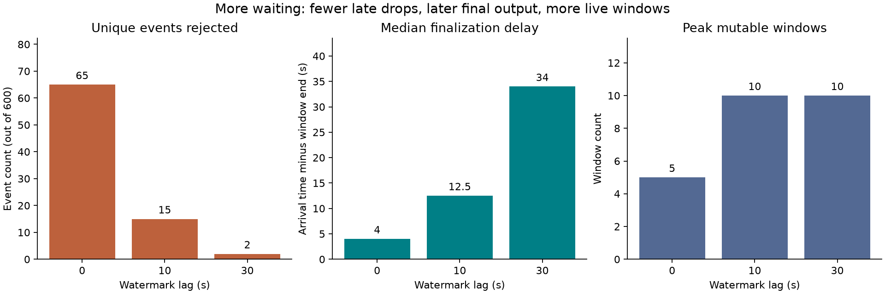
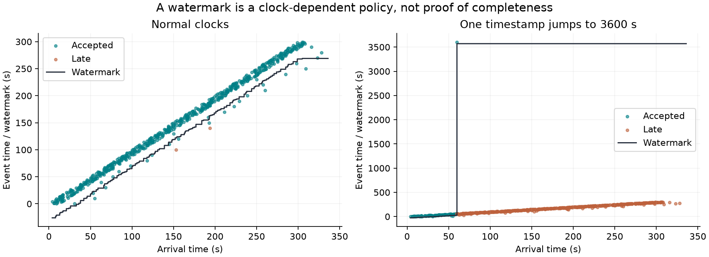

# Watermark Replay Engine

A small, original Python/SQLite processor for **out-of-order event-time windows**.
Its contract is deliberately narrow: one ordered, replayable source log; exact
integer aggregates; final-only output; and atomic state transitions in one local
database. It demonstrates durable stream-processing logic, not a distributed
streaming framework or a historical feature store.

The central question is: **after a crash or a lost acknowledgement, can we replay
the same source offsets without changing aggregates, late-data decisions, or
the final-output log?** The test suite includes real subprocess termination,
not only mocked exceptions.

## Run it

Python 3.11 or later:

```bash
python3 -m venv .venv
source .venv/bin/activate
python -m pip install '.[test]'
python -m pytest -W error
watermark-demo --output results
```

The core processor uses the Python standard library. Matplotlib is needed for
the demo; pytest is a test extra. To reproduce the recorded dependency versions:

```bash
python -m pip install -r requirements-repro.txt
python -m pip install --no-deps .
```

Reinstall the package after editing source. The demo creates its own temporary
SQLite databases, checks uninterrupted processing against restart/replay and an
independent batch oracle, then removes those temporary databases. It writes
`summary.json`, `window-outputs.json`, and two plots in the requested output
directory. Only generated demo artifacts at that destination are overwritten.
No external data, API keys, or network access is required to run the demo.

## Event-time contract

An event has immutable `event_id`, `key`, `timestamp`, and `value`. Timestamps are
nonnegative integer seconds; values are signed 64-bit integers (the demo uses
synthetic latency measurements in microseconds). For window width `H`:

```text
start = (timestamp // H) * H
window = [start, start + H)
watermark = largest unique event timestamp seen so far - lag
```

The watermark starts unset. For each **new unique event**, admission uses the
**previous watermark**: reject the event as late exactly when its window end
is `<= watermark`. Otherwise update its keyed window, advance the frontier, and
finalize every window whose end is now `<= watermark`.

For example, with width 10 and watermark 15, an event at time 11 is accepted
into `[10,20)`, despite being older than the watermark. An event at time 9 is
rejected from `[0,10)`. At watermark exactly 10, `[0,10)` is already closed.
Windows with no accepted rows do not produce empty output records.

This model is inspired by the separation of event time, watermarks, and window
lateness in [Apache Flink's window documentation](https://nightlies.apache.org/flink/flink-docs-stable/docs/dev/datastream/operators/windows/).
It is **not a Flink compatibility layer**. Our exact integer boundary convention
is defined above; there are no periodic watermark timers or post-finalization
corrections. `lag` delays the watermark; it is not extra allowed lateness after
closure. It is a chosen policy, not a proven bound on producer delays.

An explicit `finish(offset)` marker finalizes all remaining windows and closes
the finite source. It does not pretend to be a wall-clock timeout or encode
infinity in JSON. An idle source does not advance its watermark automatically.

## Durable replay and atomic output

```text
ordered source offset
    → BEGIN IMMEDIATE
    → receipt / immutable-ID checks
    → admission + aggregate + watermark
    → final-window outbox + next offset + receipt
    → COMMIT
    → return acknowledgement
```

The implementation explicitly uses SQLite transactions, rollback journaling,
and `synchronous=FULL` for file-backed databases. On an exception, it rolls back
any still-active transaction before re-raising. See SQLite's
[transaction semantics](https://www.sqlite.org/lang_transaction.html) and
[atomic-commit description](https://www.sqlite.org/atomiccommit.html).

Two identities serve different purposes:

| Input case | Effect |
| --- | --- |
| Same offset, identical record | Return its original stored outcome; no state change |
| Same offset, different record | Raise `ConflictError`; no state change |
| New contiguous offset, known event ID and identical event | Record `duplicate`; advance offset, not the aggregate |
| Known event ID with changed content | Raise `ConflictError`; do not consume offset |
| Offset skips `next_offset` | Raise `OffsetError`; no state change |
| New unique event for a closed window | Record `late` durably; no aggregate change |
| New record after `finish` | Raise `StreamClosedError` |

Old offsets remain replayable even after finish. A late event ID is remembered,
so repeated delivery cannot turn it into accepted data. Malformed input, an
unrepresentable window end, or aggregate integer overflow fails before commit;
integer sums are never silently promoted to floating point.

Each finalized `(key, start)` has one immutable **outbox row** in the same
transaction as its aggregate. There is no network publisher here. Calling
`outputs()` repeatedly rereads the rows; an external consumer would need a
cursor, idempotency keyed by `(key, start)`, and its own delivery/recovery
contract. **Local idempotent state transitions do not imply distributed
exactly-once delivery.** A returned retry outcome describes the original
transaction, not the current watermark and not a new output notification.

## Deterministic experiment and observed results

Seed `20261014` generates 600 unique readings for five sensors over event times
0–299 seconds. Ordinary delivery delay is uniformly sampled from 0–12 seconds;
every twentieth event has delay 20–60 seconds. Every tenth event has one duplicate
delivery, delayed an additional 1–20 seconds. The 660 deliveries are sorted by
`(arrival_time, event_id)` to create the immutable source-offset order.

All cases use 30-second keyed windows. Results from the committed
[summary](results/summary.json):

| Watermark lag | Accepted unique events | Late unique events | Median finalization delay | Peak live windows |
| ---: | ---: | ---: | ---: | ---: |
| 0 s | 535 | 65 | 4.0 s | 5 |
| 10 s | 585 | 15 | 12.5 s | 10 |
| 30 s | 598 | 2 | 34.0 s | 10 |

Each case recognizes all 60 duplicate deliveries and emits 50 final windows.
Final aggregates match a plain-Python oracle that classifies the ordered stream
and then batch-groups accepted events. A halfway restart, replay of seven prior
offsets, and a full replay after finish produce an identical logical-state hash.
Hashes include receipts, event decisions, aggregates, outbox rows, and metadata;
they do not depend on database file layout or temporary paths.



Finalization delay means **synthetic arrival time at emission minus window end**,
not measured processing latency. End-of-stream occurs one second after the last
delivery. Finish, rather than watermark progress, closes 5, 5, and 10 windows
respectively. Peak live windows is measured immediately after each transaction;
it excludes finalized rows, receipts, and the deduplication history retained on
disk. This is not a memory or throughput benchmark.

The clock-skew stress case inserts one event at arrival time 60 seconds with a
reported event time of 3600 seconds. With a 30-second lag, 495 of 601 unique events
are then rejected as late. The resulting 106 accepted events include the bad-clock
event. Replay remains consistent, but the policy is no longer useful for retaining
normal readings. The summary deliberately reports no finalization-delay statistic
for this case because event and arrival clocks are inconsistent.



These are synthetic mechanism demonstrations, not measured production reliability
or an estimate of a real telemetry population. No clocks are repaired or records
quarantined automatically. Future-timestamp validation would require an explicit
producer/clock policy beyond this example.

## Minimal API example

```python
from pathlib import Path
from tempfile import TemporaryDirectory
from watermark_replay import Engine, Event

with TemporaryDirectory() as directory:
    with Engine(Path(directory) / "stream.sqlite", width=10, lag=0) as stream:
        event = Event("event-0", "sensor-a", 2, 1200)
        print(stream.ingest(0, event))
        print(stream.ingest(0, event))  # lost-ACK retry, no new state
        print(stream.ingest(1, event))  # new-offset duplicate, still counted once
        stream.ingest(2, Event("event-1", "sensor-a", 10, 900))
        stream.finish(3)
        print(stream.outputs())
```

## Validation and boundaries

Tests cover half-open boundaries, key isolation, admission relative to the previous
watermark, replay after finish, new-offset duplicates, immutable payload conflicts,
late-record persistence, contiguous offsets, empty streams, output immutability,
integer overflow, invalid data, configuration mismatch on reopen, and randomized
arrival permutations against the batch oracle.

Failure tests inject exceptions after event updates, after finalization, and before
commit, including during finish. Separate subprocesses call `os._exit` at each
pre-commit phase and immediately after commit; reopening and replaying must equal
a clean run. These test process termination and lost acknowledgements, **not
power-loss behavior, filesystem corruption, disk exhaustion, or all SQLite failure
modes**. SQLite supplies the underlying transactional guarantees.

The processor is intentionally single-source, single-writer, and local-file based.
There is no partition watermark merging, idle-partition handling, broker consumer,
distributed checkpoint, consumer acknowledgement table, schema migration, update,
deletion, retraction, or retention policy. `snapshot()` assumes no concurrent writer.
The configuration is immutable on reopen. Use a dedicated database, not a shared
application database; an in-memory SQLite database is not durable.

Receipts, unique event IDs, finalized aggregates, and outbox rows are kept forever:
**storage grows with source history**. Adding retention would change the replay
and deduplication guarantees and needs a separately specified replay horizon.
Different source orders can legitimately yield different late-data decisions.
Reproducibility means replaying the **same ordered log and configuration**, not
arbitrary-order invariance or equality with aggregates of all events.

The implementation is original; stream-processing concepts and SQLite semantics
are attributed above. No private data, external datasets, personal history, or
employment claims are included. MIT licensed.
